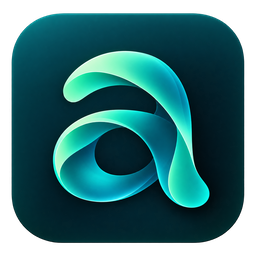
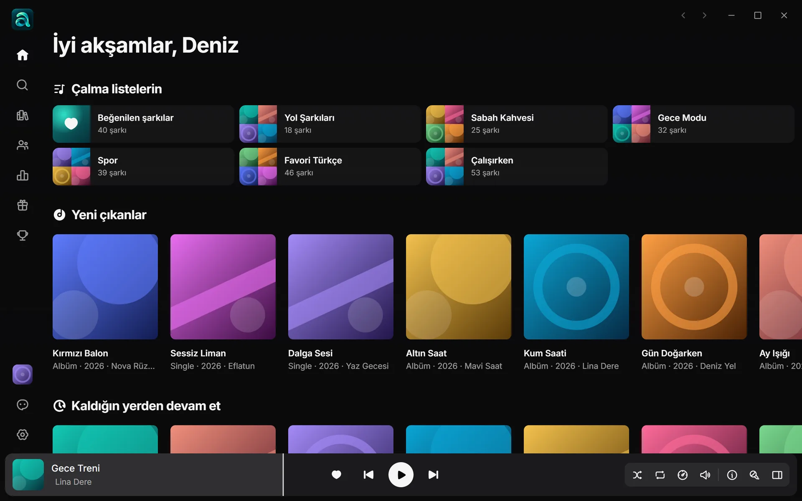
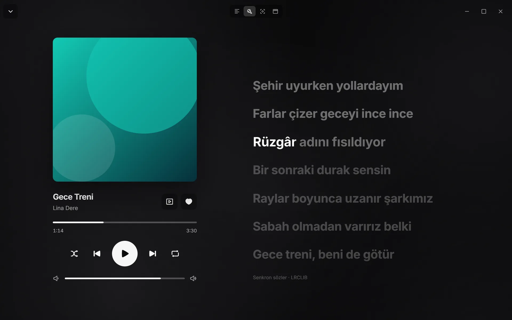
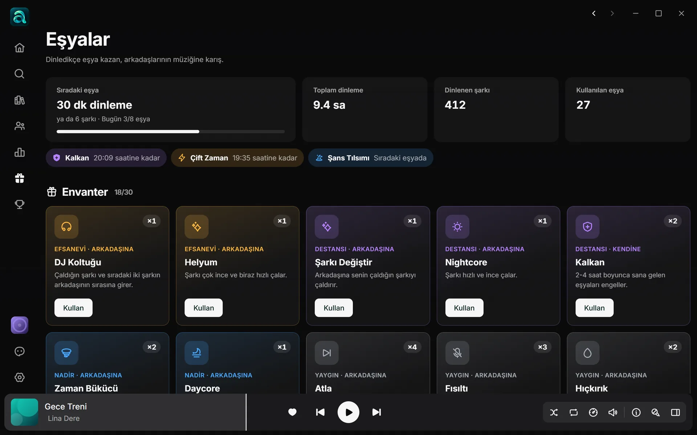
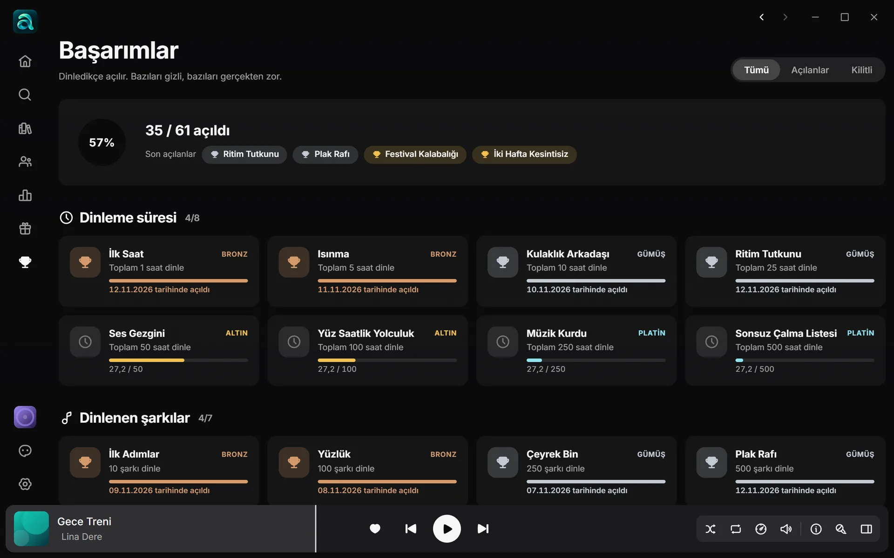
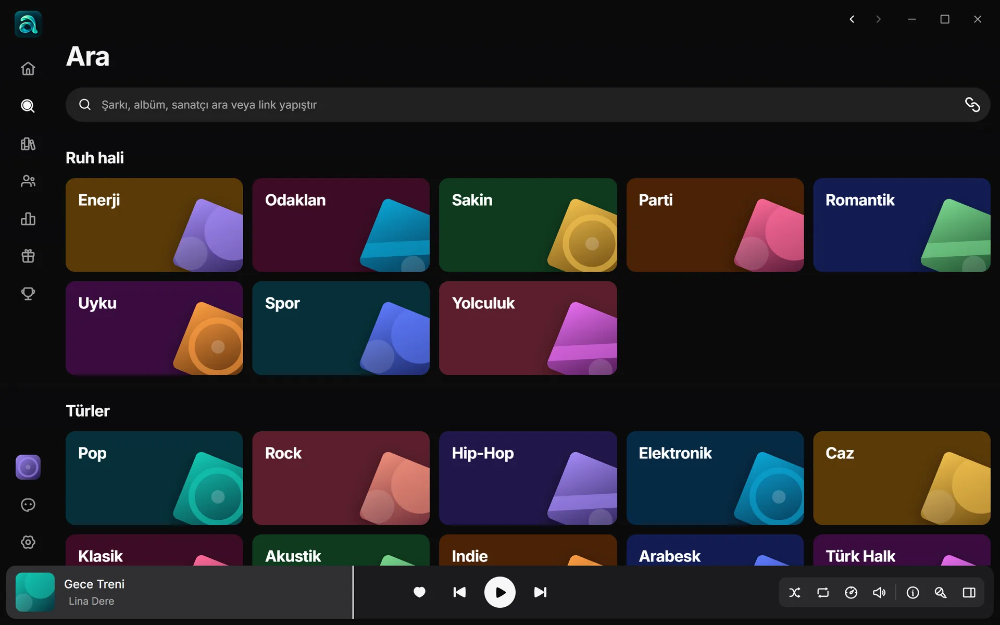

<h1 align="center">Ausy Music</h1>

  Windows için ücretsiz müzik uygulaması: senkron sözler, kişisel karışımlar, arkadaşlarla birlikte dinleme, eşyalar ve başarımlar. 
  <i>A free music app for Windows: synced lyrics, personal mixes, listening together with friends, items and achievements.</i>

  <a href="https://github.com/o7xMarasli/ausymusic-releases/releases/latest"><b>⬇ Windows için indir / Download</b></a> ·
  <a href="https://o7xmarasli.github.io/ausymusic-releases/">Web sitesi / Website</a> ·
  <a href="https://github.com/o7xMarasli/ausymusic-releases/issues/new/choose">Geri bildirim / Feedback</a>

## Kurulum

1. [Son sürümün](https://github.com/o7xMarasli/ausymusic-releases/releases/latest) sayfasından `Ausy.Music_..._x64-setup.exe` dosyasını indir ve çalıştır.
2. Windows uyarı gösterirse **Ek bilgi → Yine de çalıştır**. Uygulamanın henüz ticari kod imzası yok; güncellemeler ise uygulama tarafından imzası doğrulanarak kurulur.
3. Ücretsiz hesabını aç ya da Google ile giriş yap.

Windows 10 ve 11, 64 bit. Kurulumdan sonra yeni sürümler uygulama tarafından kendiliğinden kurulur, müzik çalarken bile. Android sürümü geliştiriliyor.

## Öne çıkanlar

<table>
  <tr>
    <td width="50%"></td>
    <td><b>Sözler şarkıyla akar.</b> Satır satır ve karaoke görünümünde kelime kelime ilerleyen senkron sözler. LRCLIB, NetEase ve YouTube Music birlikte aranır, en iyi eşleşen söz seçilir.</td>
  </tr>
  <tr>
    <td></td>
    <td><b>Eşyalar.</b> Dinledikçe 46 farklı eşyadan rastgele düşer. Karşılıklı takipleştiğin arkadaşlarına Sincap Sesi, Nightcore ya da Plak Durması gönder; Kalkan'la kendini koru. İstemezsen ayarlardan kapat.</td>
  </tr>
  <tr>
    <td></td>
    <td><b>61 başarım.</b> Dinleme süresi, seri ve çeşitlilik başarımları bronzdan platine; bazıları açılana kadar gizli.</td>
  </tr>
  <tr>
    <td></td>
    <td><b>Keşfet.</b> Ruh hali ve tür sayfaları, kaydırdıkça yüklenen arama sonuçları, link yapıştırarak çalma listesi içe aktarma.</td>
  </tr>
</table>

**Ve dahası:** Daily Mix · Haftalık Keşifler · uygulamadaki herkesin en çok dinledikleri · Jam (birlikte dinleme) · 10 bantlı ekolayzır, hız, perde ve yankı · internetsiz dinleme ve yerel dosyalar · dinamik ada ve mini oynatıcı · özelleştirilebilir klavye kısayolları · koyu ve açık tema · uyku zamanlayıcı · istatistikler · Türkçe, İngilizce, Almanca, İtalyanca.

## Geri bildirim

Bir hata bulduysan ya da fikrin varsa uygulamada sol alttaki **geri bildirim** düğmesini kullan ya da burada [yeni bir kayıt aç](https://github.com/o7xMarasli/ausymusic-releases/issues/new/choose). Lütfen e-posta, şifre ya da kişisel bilgi yazma; buradaki her şey herkese açıktır.

## English

**Install:** download `Ausy.Music_..._x64-setup.exe` from the [latest release](https://github.com/o7xMarasli/ausymusic-releases/releases/latest) and run it. If Windows warns you, choose **More info → Run anyway**. Windows 10 and 11, 64-bit; the app updates itself. Android is in development.

**Feedback:** use the feedback button at the bottom left of the app or [open an issue](https://github.com/o7xMarasli/ausymusic-releases/issues/new/choose).

---

Ausy Music bağımsız bir projedir; YouTube, Spotify veya bağlı şirketlerle ilişkisi yoktur. Ekran görüntülerindeki şarkı ve sanatçı adları örnektir.
Ausy Music is an independent project and is not affiliated with YouTube, Spotify or their companies.
